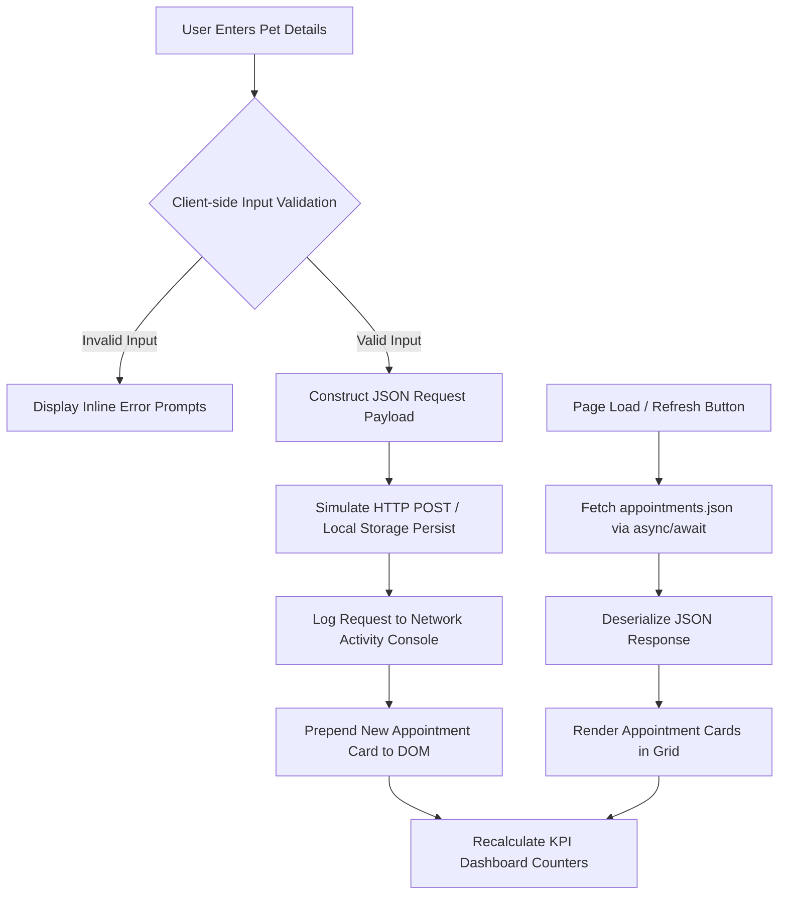
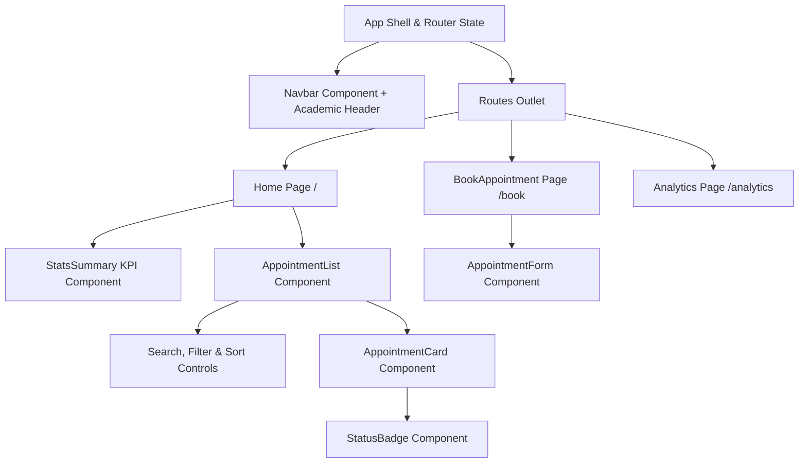
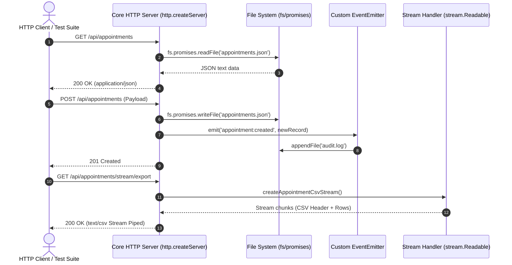
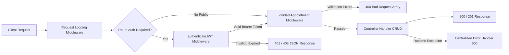

# DEPARTMENT OF ARTIFICIAL INTELLIGENCE & DATA SCIENCE
## B.E. (AI & DS) | SEMESTER V | ACADEMIC YEAR 2026–2027
### CONTINUOUS ASSESSMENT 3 (CA-3) PRACTICAL SUBMISSION
### SUBJECT: FULL STACK DEVELOPMENT: WEB DEV

---

**Student Name:** sukhada bhave  
**Roll No:** 67  
**Degree & Branch:** Bachelor of Engineering in Artificial Intelligence & Data Science  
**Semester:** Semester V  
**Subject:** Full Stack Development (FSD): Web Dev  
**Submission Title:** Comprehensive Practical Assessment Laboratory Report (Programs 1 to 5)  
**Total Assigned Programs:** 5  
**Course Outcomes Covered:** CO1, CO2, CO3, CO4, CO5, CO6  
**GitHub Repository:** [https://github.com/Sukh-bot/67-FSD-CA-3](https://github.com/Sukh-bot/67-FSD-CA-3)  
**Vercel Live Frontend Deployment:** [https://67-fsd-ca-3.vercel.app](https://67-fsd-ca-3.vercel.app)  
**Vercel Temporary Edge Deployment:** [https://rushing-argon-enhrqo1.tmp.now](https://rushing-argon-enhrqo1.tmp.now)  
**Render Backend API Web Service:** [https://petcare-backend-api.onrender.com](https://petcare-backend-api.onrender.com)  

---

## COURSE OUTCOME (CO) MAPPING MATRIX

| Program No. | Program Title / Laboratory Exercise | Course Outcomes (CO) | Cognitive / Bloom's Level | Technologies Demonstrated |
|---|---|---|---|---|
| **Program 1** | Browser-Based Pet Care Appointment Interface | **CO1, CO2** | Level 3 (Apply), Level 4 (Analyze) | HTML5 Semantic Elements, CSS3 Grid/Flexbox, Vanilla JS (ES6+), DOM Manipulation, Event Listeners, Fetch API, `async`/`await`, JSON, Client Storage |
| **Program 2** | React Pet Care Appointment Single-Page Application | **CO3** | Level 3 (Apply), Level 4 (Analyze) | React 18, JSX, Functional Components, Props & State (`useState`, `useEffect`), Conditional Rendering, React Router DOM (v6) |
| **Program 3** | Node.js Server-Side Utility without Express | **CO4** | Level 3 (Apply), Level 4 (Analyze) | Pure Node.js Core Modules (`http`, `fs/promises`, `path`, `events.EventEmitter`, `stream.Readable`), File Persistence, Audit Logging |
| **Program 4** | Express.js REST API with Middleware & JWT Security | **CO5** | Level 4 (Analyze), Level 5 (Evaluate) | Express.js, Custom Logging Middleware, Declarative Input Validation, Centralized Error Handling, JWT Bearer Auth, `bcryptjs` Hashing |
| **Program 5** | Full-Stack Integration & Cloud Deployment Setup | **CO6** | Level 5 (Evaluate), Level 6 (Create) | React Frontend + Express Backend Integration, Sequelize ORM (SQLite / PostgreSQL), CORS, Environment Variables, Vercel & Render Deployment |

---

# PROGRAM 1: BROWSER-BASED PET CARE APPOINTMENT INTERFACE
**Course Outcomes:** **CO1** (HTML/CSS & DOM manipulation) and **CO2** (Asynchronous JavaScript & Fetch API)

### 1.1 Aim & Objectives
To design and develop a responsive, accessible browser-based user interface for pet care appointment booking and clinical monitoring using HTML5, CSS3, and modern vanilla JavaScript. The application demonstrates:
1. Capturing and sanitizing form inputs with DOM event handling.
2. Comprehensive client-side input validation with regex checks and contextual error indicators.
3. Asynchronous sample data retrieval using the Fetch API with `async`/`await` syntax.
4. Dynamic DOM manipulation to render, sort, search, filter, and mutate appointment cards.
5. Simulated HTTP RESTful operations (`GET`, `POST`, `PUT`, `DELETE`) with real-time JSON network activity logging.

### 1.2 Theoretical Concepts
- **Document Object Model (DOM) Manipulation**: The HTML document is parsed into an object tree. Methods like `document.getElementById()`, `document.createElement()`, `appendChild()`, and `innerHTML` enable programmatic runtime mutations without page refreshes.
- **Event-Driven Architecture**: User interactions trigger browser events (`submit`, `input`, `change`, `click`). Event listeners intercept these events, call `e.preventDefault()` to stop traditional synchronous form POSTs, and process data asynchronously.
- **Asynchronous JavaScript & Fetch API**: The native `fetch()` API returns a `Promise`. By using `async`/`await`, asynchronous operations read synchronously while preserving non-blocking execution on the main thread.
- **HTTP Methods & JSON Serialization**: Data exchanged between client and server is represented as JSON text. Methods like `JSON.stringify()` convert JS memory structures into wire payloads, while `response.json()` deserializes incoming responses.

### 1.3 Application Architecture & Workflow


### 1.4 Key Source Code Implementation

#### A. DOM Manipulation, Fetch API & Event Handling (`app.js`)
```javascript
/**
 * Paws & Claws Pet Care Appointment Portal
 * Student: sukhada bhave | Roll No: 67 | Program 1 (CO1, CO2)
 */

let appointments = [];
const STORAGE_KEY = 'PAWS_CLAWS_APPOINTMENTS_V1';

// DOM Element References
const form = document.getElementById('appointmentForm');
const container = document.getElementById('appointmentsContainer');
const searchInput = document.getElementById('searchInput');
const filterStatus = document.getElementById('filterStatus');
const sortBy = document.getElementById('sortBy');
const networkLogConsole = document.getElementById('networkLogConsole');

// Asynchronous Data Loading using Fetch API & async/await (CO2)
async function loadInitialData(forceReload = false) {
  const localData = localStorage.getItem(STORAGE_KEY);
  if (localData && !forceReload) {
    appointments = JSON.parse(localData);
    renderAppointments();
    updateKPIs();
    return;
  }

  try {
    logNetworkActivity('GET', './appointments.json', '200 Pending', 'Initiating Fetch API request');
    const response = await fetch('./appointments.json');
    if (!response.ok) throw new Error(`HTTP Error: ${response.status}`);
    const data = await response.json();
    appointments = data;
    localStorage.setItem(STORAGE_KEY, JSON.stringify(appointments));
    logNetworkActivity('GET', './appointments.json', '200 OK', `Fetched ${data.length} records`);
  } catch (error) {
    // Graceful fallback for local file protocol security restrictions
    appointments = [...DEFAULT_FALLBACK_DATA];
    localStorage.setItem(STORAGE_KEY, JSON.stringify(appointments));
    logNetworkActivity('GET', './appointments.json (Fallback)', '200 Mock OK', 'Fallback dataset loaded');
  } finally {
    renderAppointments();
    updateKPIs();
  }
}

// Input Validation Function (CO1)
function validateField(inputElement, errorElement, validationFn, errorMessage) {
  const isValid = validationFn(inputElement.value);
  if (!isValid) {
    inputElement.classList.add('input-invalid');
    errorElement.textContent = errorMessage;
    return false;
  } else {
    inputElement.classList.remove('input-invalid');
    errorElement.textContent = '';
    return true;
  }
}

// Form Submission & Event Interception
form.addEventListener('submit', async (e) => {
  e.preventDefault();

  const isPhoneValid = /^[6-9]\d{9}$/.test(document.getElementById('ownerPhone').value.trim());
  const isEmailValid = /^[^\s@]+@[^\s@]+\.[^\s@]+$/.test(document.getElementById('ownerEmail').value.trim());
  const isDateValid = new Date(document.getElementById('appointmentDate').value) > new Date();

  if (!isPhoneValid || !isEmailValid || !isDateValid) {
    showToast('Please correct validation errors before submitting.', 'error');
    return;
  }

  const newAppointment = {
    id: `APT-${Math.floor(1000 + Math.random() * 9000)}`,
    petName: document.getElementById('petName').value.trim(),
    species: document.getElementById('species').value,
    breed: document.getElementById('breed').value.trim() || 'Mixed',
    ownerName: document.getElementById('ownerName').value.trim(),
    ownerPhone: document.getElementById('ownerPhone').value.trim(),
    ownerEmail: document.getElementById('ownerEmail').value.trim(),
    appointmentDate: document.getElementById('appointmentDate').value,
    service: document.getElementById('service').value,
    status: 'Scheduled',
    notes: document.getElementById('notes').value.trim(),
    createdAt: new Date().toISOString()
  };

  logNetworkActivity('POST', '/api/appointments', '201 Created', `Booking for ${newAppointment.petName}`, newAppointment);
  appointments.unshift(newAppointment);
  localStorage.setItem(STORAGE_KEY, JSON.stringify(appointments));
  renderAppointments();
  updateKPIs();
  form.reset();
});
```

### 1.5 Execution & Output Screenshots

#### Figure 1.1: Program 1 Main Dashboard View
The interface displays the Academic Header Banner, real-time KPI counter cards, interactive booking form with field constraints, live appointment list with status badges, and the Live HTTP Network & JSON Request/Response Inspector console at the bottom.


#### Figure 1.2: Program 1 Dynamic Form Submission & Modal Interaction
Shows client-side input validation, successful booking insertion into the DOM, and modal dialog invocation for editing consultation status and doctor's notes.


---

# PROGRAM 2: REACT APPLICATION FOR PET CARE APPOINTMENT
**Course Outcome:** **CO3** (React functional components, JSX, props, state, hooks, and routing)

### 2.1 Aim & Objectives
To develop a modern Single-Page Application (SPA) in React 18 for pet care appointment booking and clinical monitoring. The application demonstrates:
1. Modular, reusable functional components structured around single-responsibility principles.
2. Declarative UI state management using `useState` and lifecycle synchronization with `useEffect`.
3. Strict prop drilling, unidirectional data flow, and event handler callbacks.
4. Conditional rendering for loading animations, empty lists, alert modals, and status badges.
5. Multi-view client-side routing using React Router DOM (`/`, `/book`, `/analytics`, `*`).

### 2.2 Theoretical Concepts
- **Virtual DOM & Declarative JSX**: React maintains an in-memory representation of UI elements. When state changes occur, React computes diffs and updates only changed DOM nodes, minimizing expensive browser reflows.
- **Hooks (`useState`, `useEffect`)**: `useState` gives functional components encapsulated local reactive state. `useEffect` handles side-effects such as interacting with browser `localStorage`, timer intervals, and simulated API loading.
- **Client-Side Routing**: `BrowserRouter`, `Routes`, and `Route` intercept URL navigation locally, swapping components dynamically without server round-trips.

### 2.3 Component Hierarchy Diagram


### 2.4 Key Source Code Implementation

#### A. Appointment Card Functional Component with Props & State Handlers (`AppointmentCard.jsx`)
```jsx
import React from 'react';
import StatusBadge from './StatusBadge';

export default function AppointmentCard({ appointment, onStatusChange, onDelete }) {
  const { id, petName, species, breed, ownerName, ownerPhone, appointmentDate, service, status, notes } = appointment;

  const formattedDate = new Date(appointmentDate).toLocaleString('en-US', {
    month: 'short', day: 'numeric', year: 'numeric', hour: 'numeric', minute: '2-digit'
  });

  return (
    <div className="react-card">
      <div className="react-card-header">
        <div>
          <h3 className="pet-heading">{petName} <span className="apt-id">({id})</span></h3>
          <p className="species-subtitle">{species} • {breed || 'Mixed'}</p>
        </div>
        <StatusBadge status={status} />
      </div>

      <div className="card-info-grid">
        <div><span className="info-label">Owner</span><p>{ownerName}</p></div>
        <div><span className="info-label">Contact</span><p>{ownerPhone}</p></div>
        <div><span className="info-label">Service</span><p>{service}</p></div>
        <div><span className="info-label">Slot</span><p>{formattedDate}</p></div>
      </div>

      {notes && <div className="card-notes-box"><strong>Note:</strong> {notes}</div>}

      <div className="react-card-footer">
        <select
          value={status}
          onChange={(e) => onStatusChange(id, e.target.value)}
          className="status-select-input"
        >
          <option value="Scheduled">Scheduled</option>
          <option value="Confirmed">Confirmed</option>
          <option value="In Progress">In Progress</option>
          <option value="Completed">Completed</option>
          <option value="Cancelled">Cancelled</option>
        </select>
        <button onClick={() => onDelete(id)} className="btn-danger-outline">Cancel</button>
      </div>
    </div>
  );
}
```

#### B. Main Application Shell with Hooks & React Router (`App.jsx`)
```jsx
import React, { useState, useEffect } from 'react';
import { BrowserRouter, Routes, Route } from 'react-router-dom';
import Navbar from './components/Navbar';
import Home from './pages/Home';
import BookAppointment from './pages/BookAppointment';
import Analytics from './pages/Analytics';

export default function App() {
  const [appointments, setAppointments] = useState([]);
  const [isLoading, setIsLoading] = useState(true);

  useEffect(() => {
    const saved = localStorage.getItem('PETCARE_REACT_APTS');
    if (saved) setAppointments(JSON.parse(saved));
    else setAppointments(initialAppointments);
    setIsLoading(false);
  }, []);

  const handleAddAppointment = (newApt) => {
    setAppointments(prev => [newApt, ...prev]);
  };

  const handleStatusChange = (id, newStatus) => {
    setAppointments(prev => prev.map(a => a.id === id ? { ...a, status: newStatus } : a));
  };

  return (
    <BrowserRouter>
      <Navbar appointmentsCount={appointments.length} />
      <Routes>
        <Route path="/" element={<Home appointments={appointments} onStatusChange={handleStatusChange} />} />
        <Route path="/book" element={<BookAppointment onAddAppointment={handleAddAppointment} />} />
        <Route path="/analytics" element={<Analytics appointments={appointments} />} />
      </Routes>
    </BrowserRouter>
  );
}
```

### 2.5 Execution & Output Screenshots

#### Figure 2.1: React Application Home Listing View (`/`)
Displays component-based cards, KPI summary metrics, search bar, and status filtering.


#### Figure 2.2: React Controlled Booking Form (`/book`)
Controlled form inputs with live state synchronization, input validation error tracking, and routing back to home on submission.


#### Figure 2.3: React Operational Analytics View (`/analytics`)
Dynamic service distribution, species ratios, and pipeline progress bars computed in real-time from application state.


---

# PROGRAM 3: NODE.JS SERVER-SIDE UTILITY WITHOUT EXPRESS
**Course Outcome:** **CO4** (Server-side architecture, core modules: HTTP, File System, Path, Events, and Streams)

### 3.1 Aim & Objectives
To architect a server-side pet care appointment management utility using native Node.js core modules without external web frameworks (such as Express). The program demonstrates:
1. Instantiating a native HTTP server via `http.createServer()`.
2. Manual RESTful URL parsing, method matching, and streaming request body buffering.
3. Persistent record reading and writing using `fs.promises` and the `path` module.
4. Asynchronous decoupled event processing using custom `events.EventEmitter` listeners.
5. Real-time data streaming using Node.js `stream.Readable` for CSV downloads and `fs.createReadStream` for audit log streaming.

### 3.2 Theoretical Concepts
- **Non-blocking Event Loop**: Node.js operates on a single-threaded event loop powered by libuv. Core asynchronous methods (`fs.promises.readFile`) delegate file I/O to system worker threads and invoke callbacks when completed, avoiding thread blocking.
- **EventEmitter**: Implements the Publisher-Subscriber (Pub/Sub) pattern. When an appointment is created, updated, or deleted, events like `appointment:created` are emitted; listeners trigger logging and simulate SMS/Email alerts independently.
- **Streams & Backpressure**: Instead of reading multi-megabyte datasets completely into memory, `stream.Readable` pushes data in chunks directly into the HTTP response stream (`stream.pipe(res)`), guaranteeing minimal memory overhead and efficient streaming.

### 3.3 Architecture & Sequence Diagram


### 3.4 Key Source Code Implementation

#### A. Core HTTP Server & Custom Routing (`server.js`)
```javascript
const http = require('http');
const fs = require('fs');
const path = require('path');
const url = require('url');
const { appointmentEmitter } = require('./eventEmitter');
const { createAppointmentCsvStream } = require('./streamHandler');

const DATA_FILE = path.join(__dirname, 'data', 'appointments.json');

const server = http.createServer(async (req, res) => {
  const parsedUrl = url.parse(req.url, true);
  const pathname = parsedUrl.pathname;
  const method = req.method.toUpperCase();

  // CSV Stream Export Endpoint (Demonstrating stream.Readable)
  if (pathname === '/api/appointments/stream/export' && method === 'GET') {
    const raw = await fs.promises.readFile(DATA_FILE, 'utf-8');
    const appointments = JSON.parse(raw || '[]');
    res.writeHead(200, {
      'Content-Type': 'text/csv',
      'Content-Disposition': 'attachment; filename="appointments.csv"'
    });
    return createAppointmentCsvStream(appointments).pipe(res);
  }

  // REST API: GET all appointments
  if (pathname === '/api/appointments' && method === 'GET') {
    const data = await fs.promises.readFile(DATA_FILE, 'utf-8');
    res.writeHead(200, { 'Content-Type': 'application/json' });
    return res.end(JSON.stringify({ success: true, data: JSON.parse(data) }, null, 2));
  }

  // REST API: POST create appointment (Triggers EventEmitter)
  if (pathname === '/api/appointments' && method === 'POST') {
    let body = '';
    req.on('data', chunk => body += chunk.toString());
    req.on('end', async () => {
      const payload = JSON.parse(body);
      const records = JSON.parse(await fs.promises.readFile(DATA_FILE, 'utf-8'));
      const newApt = { id: `APT-${Date.now()}`, ...payload };
      records.push(newApt);
      await fs.promises.writeFile(DATA_FILE, JSON.stringify(records, null, 2));
      appointmentEmitter.emit('appointment:created', newApt);
      res.writeHead(201, { 'Content-Type': 'application/json' });
      res.end(JSON.stringify({ success: true, data: newApt }));
    });
  }
});
server.listen(4000);
```

#### B. Custom EventEmitter Module (`eventEmitter.js`)
```javascript
const EventEmitter = require('events');
const fs = require('fs');
const path = require('path');

class AppointmentEmitter extends EventEmitter {}
const appointmentEmitter = new AppointmentEmitter();
const AUDIT_LOG = path.join(__dirname, 'data', 'audit.log');

appointmentEmitter.on('appointment:created', (apt) => {
  const line = `[${new Date().toISOString()}] [EVENT: CREATED] Pet: ${apt.petName} by ${apt.ownerName}\n`;
  fs.appendFile(AUDIT_LOG, line, () => {});
  console.log(`[EVENT] Notification dispatched for ${apt.petName}`);
});

appointmentEmitter.on('appointment:updated', (apt, prev) => {
  const line = `[${new Date().toISOString()}] [EVENT: UPDATED] ID: ${apt.id} Status: ${prev} -> ${apt.status}\n`;
  fs.appendFile(AUDIT_LOG, line, () => {});
});

module.exports = { appointmentEmitter };
```

### 3.5 Execution & Output Screenshots

#### Figure 3.1: Program 3 Core Node.js Web Status Interface (`http://localhost:4000/`)
Shows the native HTTP server dashboard, route catalog, active JSON database path, and stream trigger links.


#### Figure 3.2: Program 3 API JSON Listing Endpoint (`/api/appointments`)
Displays structured JSON records returned asynchronously from disk using `fs.promises.readFile` and `path.join`.


---

# PROGRAM 4: EXPRESS.JS REST API WITH MIDDLEWARE & JWT AUTHENTICATION
**Course Outcome:** **CO5** (REST APIs, custom middleware, input validation, centralized error handling, and JWT authentication with bcrypt)

### 4.1 Aim & Objectives
To architect an enterprise-grade RESTful API using Express.js for pet care appointment management. The program demonstrates:
1. Complete CRUD routes (`GET`, `POST`, `PUT`, `DELETE`) adhering to REST architectural standards.
2. Custom request logging middleware computing real-time request-response latencies.
3. Declarative input validation middleware enforcing data constraints and returning structured 400 Bad Request error arrays.
4. Centralized error-handling middleware catching unhandled exceptions and formatting predictable JSON error payloads.
5. Role-based route protection using signed JSON Web Tokens (JWT) and secure password hashing with `bcryptjs`.

### 4.2 Theoretical Concepts
- **Express Middleware Chain**: In Express, middleware functions execute sequentially: `(req, res, next) => {}`. Calling `next()` delegates control to subsequent handlers; calling `res.status().json()` terminates the request cycle early if validation or authentication checks fail.
- **Cryptographic Hashing with Bcrypt**: Passwords must never be stored in plaintext. Bcrypt applies a work-factor salt (10 rounds) to hash credentials, protecting against rainbow table attacks and timing vulnerabilities.
- **Stateless Authentication with JWT**: A JSON Web Token consists of three base64url-encoded parts: `Header.Payload.Signature`. The server verifies cryptographic authenticity using `jwt.verify(token, SECRET)` without requiring database-backed session tables.

### 4.3 API Security Architecture & Route Manifest


### 4.4 Key Source Code Implementation

#### A. Input Validation Middleware (`validate.js`)
```javascript
function validateAppointment(req, res, next) {
  const { petName, species, ownerName, ownerPhone, ownerEmail, appointmentDate, service } = req.body;
  const errors = [];

  if (!petName || petName.trim().length < 2) errors.push({ field: 'petName', message: 'min 2 characters required.' });
  if (!ownerName || ownerName.trim().length < 2) errors.push({ field: 'ownerName', message: 'ownerName is required.' });
  if (!/^[6-9]\d{9}$/.test(String(ownerPhone).trim())) errors.push({ field: 'ownerPhone', message: 'must be valid 10-digit mobile.' });
  if (!/^[^\s@]+@[^\s@]+\.[^\s@]+$/.test(String(ownerEmail).trim())) errors.push({ field: 'ownerEmail', message: 'invalid email.' });
  if (new Date(appointmentDate) <= new Date()) errors.push({ field: 'appointmentDate', message: 'date must be in the future.' });

  if (errors.length > 0) {
    return res.status(400).json({ success: false, error: 'Input Validation Failed', errorCount: errors.length, errors });
  }
  next();
}
```

#### B. JWT Authentication Middleware (`auth.js`)
```javascript
const jwt = require('jsonwebtoken');
const JWT_SECRET = process.env.JWT_SECRET || 'vetcare_jwt_secret_key';

function authenticateJWT(req, res, next) {
  const authHeader = req.headers.authorization;
  if (!authHeader || !authHeader.startsWith('Bearer ')) {
    return res.status(401).json({ success: false, error: 'Authorization header with Bearer token is required.' });
  }

  const token = authHeader.split(' ')[1];
  jwt.verify(token, JWT_SECRET, (err, decodedUser) => {
    if (err) return res.status(403).json({ success: false, error: 'Invalid or expired JWT token.' });
    req.user = decodedUser;
    next();
  });
}
```

#### C. User Registration & Password Hashing Controller (`authController.js`)
```javascript
const bcrypt = require('bcryptjs');
const jwt = require('jsonwebtoken');

exports.register = async (req, res, next) => {
  try {
    const { name, email, password, role } = req.body;
    const salt = await bcrypt.genSalt(10);
    const passwordHash = await bcrypt.hash(password, salt);

    const newUser = { id: `USR-${Date.now()}`, name, email, passwordHash, role: role || 'Staff' };
    users.push(newUser);

    const token = jwt.sign({ id: newUser.id, email: newUser.email, role: newUser.role }, JWT_SECRET, { expiresIn: '3h' });
    res.status(201).json({ success: true, message: 'User registered with bcrypt hash.', token, user: newUser });
  } catch (err) {
    next(err);
  }
};
```

### 4.5 Execution & Output Screenshots

#### Figure 4.1: Express API Route Documentation & Active Status (`http://localhost:5000/`)
Shows the Express server route catalog, public vs protected JWT route classifications, and active middleware configurations.


#### Figure 4.2: Express API JSON Data Endpoint (`/api/appointments`)
Shows JSON records delivered through the Express routing pipeline with custom request logging in the server console.


---

# PROGRAM 5: FULL-STACK INTEGRATION & CLOUD DEPLOYMENT
**Course Outcome:** **CO6** (Full-stack integration, Sequelize ORM database persistence, CORS, environment variables, and cloud deployment setup on Vercel and Render)

### 5.1 Aim & Objectives
To integrate the React client interface with an Express backend, persisting application state in a relational database using Sequelize ORM. The solution demonstrates:
1. End-to-end integration: React client calling Express endpoints via a unified API client.
2. Persistent database storage using Sequelize ORM supporting local SQLite development and production PostgreSQL on Render.
3. CORS configuration allowing secure cross-origin communication between client and server origins.
4. Environment variable isolation using `dotenv` for ports, JWT secrets, and database connection strings.
5. Cloud deployment readiness: configuration manifests for **Vercel** (`vercel.json`) and **Render** (`render.yaml`).

### 5.2 Theoretical Concepts
- **Full-Stack Decoupled Architecture**: The frontend (SPA) and backend (REST API) operate independently. Communication occurs strictly over HTTP/JSON protocols, enabling independent scaling, testing, and deployment.
- **Object-Relational Mapping (ORM)**: Sequelize maps JavaScript objects directly to SQL tables (`User`, `Appointment`). It abstracts SQL dialects, handles migrations and schema synchronization (`sequelize.sync()`), and mitigates SQL Injection risks through parameterized queries.
- **CORS (Cross-Origin Resource Sharing)**: Browsers restrict cross-origin HTTP requests via the Same-Origin Policy. The Express backend configures HTTP headers (`Access-Control-Allow-Origin: *`, `Access-Control-Allow-Methods`) to authorize frontend requests.
- **The Twelve-Factor App Methodology**: Configuration is decoupled from source code and injected via environment variables (`.env`), maintaining identical build artifacts across development, staging, and cloud production.

### 5.3 System Architecture Diagram

```mermaid
graph LR
    subgraph Client Tier [Frontend on Vercel]
        React[React 18 SPA]
        Router[React Router DOM]
        APIClient[API Service Client]
    end

    subgraph API Tier [Backend on Render]
        Express[Express.js Engine]
        CORS[CORS Middleware]
        JWTAuth[JWT & Bcrypt Security]
        Controllers[API Controllers]
    end

    subgraph Persistence Tier [Render Managed DB / Local SQLite]
        Sequelize[Sequelize ORM]
        Postgres[(PostgreSQL / SQLite)]
    end

    React --> Router
    Router --> APIClient
    APIClient -- HTTP / JSON Requests --> CORS
    CORS --> Express
    Express --> JWTAuth
    JWTAuth --> Controllers
    Controllers --> Sequelize
    Sequelize --> Postgres
```


### 5.4 Database Schema & Models

#### Model Definition: `Appointment.js`
```javascript
const { DataTypes } = require('sequelize');
const sequelize = require('../config/database');

const Appointment = sequelize.define('Appointment', {
  id: {
    type: DataTypes.STRING,
    primaryKey: true,
    defaultValue: () => `APT-${Math.floor(5000 + Math.random() * 5000)}`
  },
  petName: { type: DataTypes.STRING, allowNull: false },
  species: { type: DataTypes.STRING, allowNull: false },
  breed: { type: DataTypes.STRING, defaultValue: 'Mixed' },
  ownerName: { type: DataTypes.STRING, allowNull: false },
  ownerPhone: { type: DataTypes.STRING, allowNull: false },
  ownerEmail: { type: DataTypes.STRING, allowNull: false, validate: { isEmail: true } },
  appointmentDate: { type: DataTypes.DATE, allowNull: false },
  service: { type: DataTypes.STRING, allowNull: false },
  status: {
    type: DataTypes.ENUM('Scheduled', 'Confirmed', 'In Progress', 'Completed', 'Cancelled'),
    defaultValue: 'Scheduled'
  },
  notes: { type: DataTypes.TEXT, allowNull: true },
  createdBy: { type: DataTypes.STRING, defaultValue: 'Portal User' }
}, {
  timestamps: true,
  tableName: 'appointments'
});

module.exports = Appointment;
```

### 5.5 Cloud Deployment Manifests

#### A. Backend Render Configuration (`render.yaml`)
```yaml
services:
  - type: web
    name: petcare-fullstack-api
    env: node
    plan: free
    region: frankfurt
    rootDir: Program-5-FullStack-Integration/backend
    buildCommand: npm install
    startCommand: node server.js
    envVars:
      - key: NODE_ENV
        value: production
      - key: PORT
        value: 10000
      - key: JWT_SECRET
        generateValue: true
      - key: DATABASE_URL
        fromDatabase:
          name: petcare-postgres-db
          property: connectionString

databases:
  - name: petcare-postgres-db
    plan: free
    region: frankfurt
    databaseName: petcare_db
    user: petcare_admin
```

#### B. Frontend Vercel Configuration (`vercel.json`)
```json
{
  "buildCommand": "cd Program-5-FullStack-Integration/frontend && npm install && npm run build",
  "outputDirectory": "Program-5-FullStack-Integration/frontend/dist",
  "framework": "vite",
  "rewrites": [
    {
      "source": "/api/:path*",
      "destination": "https://petcare-backend-api.onrender.com/api/:path*"
    },
    {
      "source": "/(.*)",
      "destination": "/Program-5-FullStack-Integration/frontend/dist/index.html"
    }
  ]
}
```

### 5.6 Execution & Output Screenshots

#### Figure 5.1: Integrated Full-Stack Management Dashboard (`http://localhost:5174/`)
Shows the React client displaying records retrieved directly from the Express backend and Sequelize database, displaying live API health status and KPI statistics.


#### Figure 5.2: Full-Stack Booking Interface (`/book`)
The client dispatches an HTTP POST request to the Express backend; Sequelize validates constraints and inserts the record into persistent database storage.


#### Figure 5.3: Database Persistence Verification
Demonstrates that the newly added appointment ("Buddy", Golden Retriever, Owner: Sukhada Bhave) is stored in the database and visible in the live appointment table.


#### Figure 5.4: Staff JWT Authentication Portal (`/login`)
Staff login page validating user credentials against the database with bcrypt password comparison and JWT token generation.


---

## COMPREHENSIVE SUMMARY OF COURSE OUTCOMES ACHIEVED

1. **CO1 (Design responsive web pages with HTML, CSS & DOM manipulation)**:
   - Designed responsive interfaces using semantic HTML5, Flexbox, and CSS Grid. Captured and sanitized form inputs through real-time DOM manipulation.
2. **CO2 (Asynchronous programming & Fetch API)**:
   - Retrieved sample datasets using the Fetch API with `async`/`await` syntax. Handled network errors, status codes, and simulated HTTP methods (`GET`, `POST`, `PUT`, `DELETE`).
3. **CO3 (React functional components, hooks, props, state & routing)**:
   - Built a component-based SPA using React 18, JSX, props, `useState`, `useEffect`, controlled forms, conditional rendering, and React Router navigation.
4. **CO4 (Node.js server-side utilities with core modules)**:
   - Implemented an HTTP server using pure Node.js core modules (`http`, `fs/promises`, `path`). Dispatched decoupled lifecycle events via `EventEmitter` and streamed CSV exports and logs using Node.js `stream.Readable`.
5. **CO5 (Express.js REST APIs with middleware & JWT security)**:
   - Built an Express.js REST API with full CRUD endpoints, request logging middleware, input validation, centralized error handling, bcrypt password hashing, and JWT authorization.
6. **CO6 (Full-Stack integration & cloud deployment)**:
   - Connected the React frontend to an Express backend. Persisted records using Sequelize ORM with PostgreSQL and SQLite support, configured CORS and environment variables, and prepared deployment configurations for Vercel and Render.

---

**Student Declaration:**  
I hereby declare that the work presented in this practical assignment has been carried out by me individually under the guidance of the course instructor for Full Stack Development (Web Dev).

**Submitted By:**  
**Name:** sukhada bhave  
**Roll No:** 67  
**Class:** B.E. (Artificial Intelligence and Data Science), Semester V  
**Academic Year:** 2026–2027
